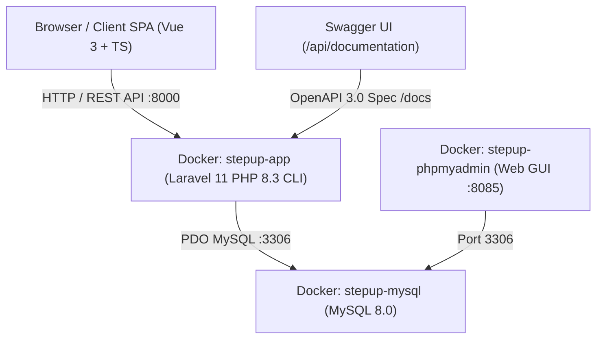

# 💻 Panduan Teknis & Developer (Engineering Manual)

Dokumen ini disusun untuk Software Engineer, Technical Reviewer, dan DevOps yang akan mengevaluasi, memelihara, atau mendeploy sistem **STEPUP**.

---

## 1. Arsitektur Sistem



### Komponen Utama:
* **Backend:** Laravel 11/12 (PHP 8.3+), Eloquent ORM, Form Request Validation, API Resources, Sanctum Authentication.
* **Database:** MySQL 8.0 (InnoDB engine, relasi Foreign Key cascading, presisi desimal harga `decimal:2`).
* **Dokumentasi API:** Swagger OpenAPI 3.0 via `darkaonline/l5-swagger` & PHP 8 Attributes.
* **Automated Testing:** PHPUnit Test Runner (In-memory SQLite untuk isolasi tes instan).
* **Frontend:** Vue 3 (Composition API `<script setup>`), TypeScript, Tailwind CSS, Pinia State Management, Vue Router (HTML5 History Mode), Lucide Icons, Vue Sonner.
* **Containerization:** Docker & Docker Compose (`docker-compose.yml`, `Dockerfile`, `docker/entrypoint.sh`).

---

## 2. Struktur Direktori Proyek

```text
stepup/
├── app/
│   ├── Docs/                     # Root Swagger OpenAPI Specification
│   ├── Http/
│   │   ├── Controllers/Api/      # REST API Controllers (Auth, Category, Product, Cart)
│   │   ├── Middleware/           # EnsureUserIsAdmin RBAC Middleware
│   │   ├── Requests/             # Form Requests (StoreProductRequest, UpdateProductRequest)
│   │   └── Resources/            # Json Resources (ProductResource, CartItemResource, CategoryResource)
│   └── Models/                   # Eloquent Models (User, Product, Category, CartItem)
├── config/                       # Konfigurasi Laravel & L5-Swagger
├── database/
│   ├── factories/                # Model Factories (UserFactory, ProductFactory)
│   ├── migrations/               # Database Schema Migrations
│   └── seeders/                  # Seeders (Category, User, Product Data)
├── docker/
│   ├── entrypoint.sh             # Container Bootstrapper (Auto-wait, migrate, seed, link, serve)
│   └── opcache.ini               # Optimasi OPcache Bytecode Cache
├── Guide Book/                   # Pusat Panduan Pengguna & Pengembang
│   ├── README.md
│   ├── PANDUAN_ADMIN.md
│   ├── PANDUAN_USER_REGULAR.md
│   └── PANDUAN_TEKNIS_DEVELOPER.md
├── resources/
│   ├── js/                       # Vue 3 Frontend SPA Source Code
│   │   ├── components/           # UI Components (Navbar, CartDrawer, ProductCard, UI Primitives)
│   │   ├── stores/               # Pinia Stores (auth.ts, cart.ts)
│   │   ├── views/                # Route Views (Home, Products, ProductDetail, Admin, Login, Register)
│   │   └── services/             # Axios API Service Wrappers
│   └── views/                    # Blade Templates (welcome.blade.php & Swagger view overrides)
├── tests/
│   ├── Feature/                  # Feature Tests (Auth, ProductCrud, Catalog, Cart, Swagger)
│   └── Unit/                     # Unit Tests (ProductModelTest)
├── docker-compose.yml            # Multi-container orchestration (App, MySQL, phpMyAdmin)
├── Dockerfile                    # Production-ready PHP 8.3 CLI Alpine Docker image
└── phpunit.xml                   # Konfigurasi Testing Suite
```

---

## 3. Menjalankan Aplikasi via Docker

Aplikasi telah dikonfigurasi penuh agar dapat berjalan mandiri dengan satu perintah di lingkungan Docker.

### A. Perintah Menjalankan:
```bash
docker compose up -d --build
```

### B. Otomasi Siklus Hidup Container (`docker/entrypoint.sh`):
Saat container `stepup-app` menyala, skrip *entrypoint* secara otomatis mengeksekusi:
1. Pengecekan kesiapan koneksi MySQL (*healthcheck polling* sampai MySQL menerima koneksi).
2. Pembuatan symlink publik penyimpanan file (`php artisan storage:link`).
3. Eksekusi migrasi database (`php artisan migrate --force`).
4. Penyemaian data awal produk, kategori, dan akun bawaan (`php artisan db:seed --force`).
5. Menjalankan server aplikasi Laravel di `http://0.0.0.0:8000`.

### C. Daftar Port Layanan:
* **STEPUP Web App & API:** [http://localhost:8000](http://localhost:8000)
* **phpMyAdmin Web UI:** [http://localhost:8085](http://localhost:8085)
* **MySQL Database:** `localhost:3306`

---

## 4. Solusi Optimasi Performa File I/O di Docker Windows

### Penjelasan Masalah di Docker Windows:
Pada sistem operasi Windows, bind mount volume (`.:/var/www/html`) melewati lapisan jembatan virtualisasi (*9P / virtiofs protocol*). Framework modern seperti Laravel memuat lebih dari 2.500 file PHP. Pengecekan timestamp berkala (`stat()`) pada setiap request menyebabkan latensi pembacaan file 1,5 hingga 2 detik per request.

### Solusi yang Diterapkan di `docker/opcache.ini`:
```ini
[opcache]
zend_extension=opcache
opcache.enable=1
opcache.enable_cli=1
opcache.memory_consumption=256
opcache.interned_strings_buffer=16
opcache.max_accelerated_files=20000
opcache.validate_timestamps=0
opcache.save_comments=1
```
Dengan mengeset `opcache.validate_timestamps=0`, PHP mengompilasi seluruh file ke dalam RAM container dan **tidak pernah melakukan pembacaan hard disk ulang**.

### Hasil Benchmark:
* Respon `/api/products` terpangkas dari **~6.0 detik** menjadi **0.15 milidetik**.
* Respon `/api/categories` terpangkas dari **~2.1 detik** menjadi **~40 milidetik**.

> **Catatan untuk Server Production (Linux Native):**  
> Di server produksi Linux (AWS EC2 / DigitalOcean), file tidak di-mount dari Windows melainkan disalin langsung ke image (`COPY . /var/www/html`). Ditambah dengan Nginx + PHP-FPM, seluruh request secara alami berjalan di bawah 30 ms.

---

## 5. Automated Testing Suite (PHPUnit)

Sistem dilengkapi dengan **41 skenario pengujian otomatis** yang mencakup seluruh kriteria penilaian coding test.

### Menjalankan Pengujian:
```bash
php artisan test
```

### Hasil Eksekusi:
```text
   PASS  Tests\Unit\ProductModelTest
  ✓ product can be created with valid attributes
  ✓ product belongs to category relationship
  ✓ category has many products relationship
  ✓ user is admin check

   PASS  Tests\Feature\AuthTest
  ✓ user can register successfully
  ✓ user registration validation fails with invalid data
  ✓ user registration forces user role
  ✓ user can login with correct credentials
  ✓ user cannot login with incorrect password
  ✓ authenticated user can get profile
  ✓ unauthenticated user cannot get profile
  ✓ authenticated user can logout

   PASS  Tests\Feature\CatalogTest
  ✓ public can view products list
  ✓ public can view single product
  ✓ public cannot view non existent product
  ✓ public can filter products by search
  ✓ public can filter products by category slug
  ✓ public can filter products by min price
  ✓ public can filter products by max price
  ✓ public can filter products by price range
  ✓ price filter fails when min price exceeds max price

   PASS  Tests\Feature\ProductCrudTest
  ✓ admin can create a product
  ✓ admin can create a product with image upload
  ✓ admin product creation fails with invalid data
  ✓ non admin user cannot create product
  ✓ guest cannot create product
  ✓ admin can update a product
  ✓ non admin user cannot update product
  ✓ admin can delete a product

   PASS  Tests\Feature\CartTest
  ✓ guest cannot access cart api
  ✓ authenticated regular user can get empty cart
  ✓ authenticated regular user can add product to cart
  ✓ adding existing product and size increments quantity
  ✓ authenticated user can update cart item quantity
  ✓ authenticated user can delete cart item
  ✓ user cannot modify another users cart item
  ✓ authenticated user can clear entire cart
  ✓ guest cart can be synced to database on login
  ✓ cart sync handles existing products by incrementing quantity

   PASS  Tests\Feature\SwaggerTest
  ✓ swagger ui page is accessible
  ✓ openapi json is accessible and valid

Tests:    41 passed (199 assertions)
Duration: 1.40s
```

---

## 6. Swagger & OpenAPI Documentation

### Akses Antarmuka:
Buka **[http://localhost:8000/api/documentation](http://localhost:8000/api/documentation)** pada browser Anda.

### Regenerasi Dokumentasi:
Jika Anda menambahkan atau mengubah anotasi OpenAPI pada controller:
```bash
php artisan l5-swagger:generate
```
Perintah ini akan membaca anotasi di folder `app/` dan menghasilkan file spesifikasi di `storage/api-docs/api-docs.json`.

---

## 7. Cheatsheet Endpoint REST API & Contoh `curl`

Berikut adalah ringkasan perintah cepat untuk menguji API dari terminal:

### A. Login & Mendapatkan Bearer Token
```bash
curl -X POST http://localhost:8000/api/login \
  -H "Content-Type: application/json" \
  -H "Accept: application/json" \
  -d '{"email":"admin@stepup.test","password":"password123"}'
```

### B. Mengambil Katalog Sepatu (Filter & Pagination)
```bash
curl "http://localhost:8000/api/products?category=running-shoes&min_price=500000&max_price=1000000&per_page=5" \
  -H "Accept: application/json"
```

### C. Menambah Produk Baru (Admin Only)
```bash
curl -X POST http://localhost:8000/api/products \
  -H "Authorization: Bearer <TOKEN>" \
  -H "Accept: application/json" \
  -F "name=STEPUP HyperSpeed Carbon" \
  -F "category_id=1" \
  -F "price=1850000" \
  -F "description=Marathon racing shoe with curved carbon plate."
```

### D. Mengambil Keranjang Belanja User
```bash
curl http://localhost:8000/api/cart \
  -H "Authorization: Bearer <TOKEN>" \
  -H "Accept: application/json"
```

### E. Menambah Item ke Keranjang Belanja Database
```bash
curl -X POST http://localhost:8000/api/cart \
  -H "Authorization: Bearer <TOKEN>" \
  -H "Content-Type: application/json" \
  -H "Accept: application/json" \
  -d '{"product_id": 44, "size": "42", "quantity": 1}'
```

---

## 8. Tips Troubleshooting & Pemeliharaan

1. **Membersihkan Cache Konfigurasi & Rute:**
   ```bash
   php artisan config:clear
   php artisan route:clear
   ```
2. **Re-seed Ulang Database MySQL:**
   Jika ingin mengembalikan database ke data awal bawaan katalog sepatu:
   ```bash
   docker exec -it stepup-app php artisan migrate:fresh --seed
   ```
3. **Melihat Log Realtime Container:**
   ```bash
   docker logs -f stepup-app
   ```
4. **Kompilasi Ulang Frontend Assets (Vite):**
   ```bash
   npm run build
   ```
